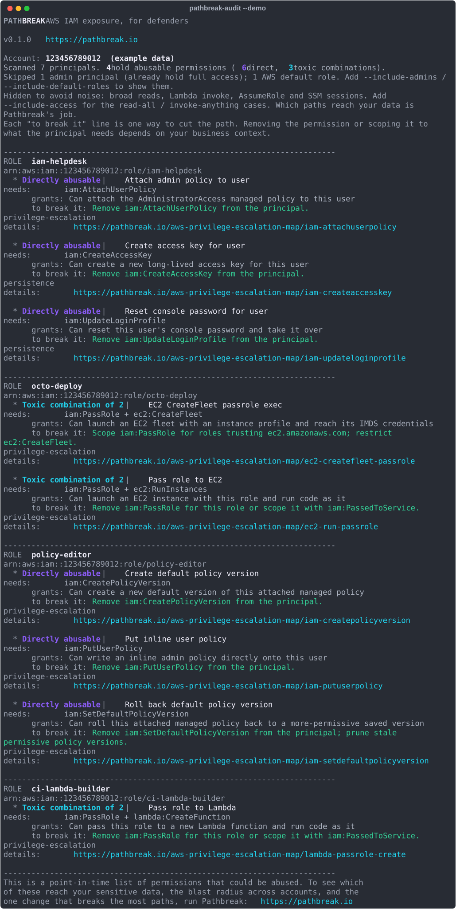

<p align="center">
  
</p>

<h1 align="center">pathbreak-audit</h1>

<p align="center">See the abusable IAM permissions your principals hold, so you can tighten them before an attacker does.</p>

<p align="center">
  <a href="https://pypi.org/project/pathbreak-audit/"></a>
  
  
  
  
</p>

---

`pathbreak-audit` is a free, read-only command line tool for defenders. Point it at an AWS account and it tells you which IAM roles and users hold dangerous permissions and toxic combinations, with the least-privilege fix for each. It is a point-in-time, single-account check that reads IAM and nothing else. Your credentials and your findings never leave your machine.

It is built and maintained by the team behind [Pathbreak](https://pathbreak.io), and the checks come from the same catalogue as the [AWS Privilege Escalation Map](https://pathbreak.io/aws-privilege-escalation-map).

## What it finds

- **Direct abusable permissions.** A single action that lets a principal escalate, persist, or evade logging, for example `iam:CreateAccessKey` on another user, or `iam:AttachUserPolicy`.
- **Toxic combinations.** Permissions that are only dangerous together, which a one-policy-at-a-time review tends to miss, for example `iam:PassRole` plus `ec2:RunInstances`.
- **The fix.** Every finding comes with the least-privilege change that removes it, and a link to the full write-up on the attack map.

Findings are labelled direct or toxic combination, ordered worst first, with the ATT&CK tactic and a link to the full write-up.

## Install

```sh
pip install pathbreak-audit
```

Or from source:

```sh
git clone https://github.com/pathbreak-io/pathbreak-audit
cd pathbreak-audit
pip install .
```

## Try it with no AWS account

```sh
pathbreak-audit --demo
```

This runs against a bundled example account so you can see the output immediately:

<p align="center">
  
</p>

## Run it against your account

Use any AWS credentials with read access to IAM. The AWS managed policies `SecurityAudit` or `ViewOnlyAccess` both cover it:

```sh
pathbreak-audit --profile my-profile
```

Useful options:

```sh
pathbreak-audit --profile my-profile --format json --out findings.json
pathbreak-audit --profile my-profile --principal admin         # filter by name
pathbreak-audit --profile my-profile --include-admins          # also show full-admin principals
pathbreak-audit --profile my-profile --include-default-roles   # also show AWS default roles
pathbreak-audit --profile my-profile --include-access          # also show broad read-all / invoke-any / assume-any
pathbreak-audit --profile my-profile --exit-code               # non-zero exit if anything is found (CI)
pathbreak-audit --profile my-profile --no-color                # plain output
```

Colour turns itself off when the output is piped or written to a file, so saved reports stay clean.

### What is left out by default (to keep the signal clean)

- **Full-admin principals.** Anyone already allowed `*` trips every check and is admin by design. `--include-admins` shows them.
- **AWS default roles.** Service-linked, SSO reserved, Control Tower, Organizations, StackSets. `--include-default-roles` shows them.
- **Broad access actions.** Reading secrets and data, `lambda:InvokeFunction`, `sts:AssumeRole`, SSM sessions. These only matter if the resource they reach is privileged, which this tool cannot know, so they are hidden by default to keep the signal clean. `--include-access` shows them where the principal can do them to everything (read all secrets, invoke any function, assume any role); reading or invoking one scoped resource is left out as intended. Which of these reach something sensitive is Pathbreak's job. Escalation, persistence, logging tampering and destruction are always shown.

## How it works, and what it does not do

`pathbreak-audit` reads the policies attached to each role and user (managed, inline, and for users the policies they inherit from groups), works out the actions each principal is allowed, and matches that against the catalogue of dangerous permissions and combinations.

This is a static grant analysis, the same shape as tools like Cloudsplaining and PMapper. Be clear on the limits:

- It reads what policies **allow**. It does not fully resolve conditions, permission boundaries, or Service Control Policies. For escalation checks it does not resolve resource scope, so a narrowly scoped grant can still show up. Broad access actions (reads, invoke, assume) are hidden unless you pass `--include-access`, and even then are shown only when granted on Resource `*`. It honours an explicit `Deny` on an action, and treats an `Allow` on `NotAction` as broad.
- It is **point in time** and **single account**. It does not watch for drift and it does not traverse cross-account trust.
- It tells you a permission **could** be abused. It does not prove that the permission actually chains into a path that reaches something sensitive.

Treat the output as a prioritized starting point for tightening IAM, not a finished risk picture.

## pathbreak-audit and Pathbreak

`pathbreak-audit` shows the permissions that could be abused, principal by principal.

[Pathbreak](https://pathbreak.io) shows which of those actually chain into a validated path that reaches your sensitive data, ranks them by blast radius across every account, and hands back the single change that breaks the most paths, continuously. If this tool is useful, that is the next step.

## Permissions needed

Read-only IAM and STS. Either of these AWS managed policies is enough:

- `SecurityAudit`
- `ViewOnlyAccess`

## Privacy

Everything runs locally. The tool makes only read calls to the IAM and STS APIs, writes nothing to your account, and sends nothing anywhere. There is no telemetry.

## For maintainers

`pathbreak_audit/data/checks.json` is generated from the Pathbreak catalogue. To rebuild it:

```sh
python3 scripts/build_checks.py path/to/attack_primitives.yaml
```

Only public fields ship. Engine internals are not included. Run the tests with:

```sh
python3 -m pytest        # or: PYTHONPATH=. python3 tests/test_evaluate.py
```

## License

MIT. See [LICENSE](LICENSE).
